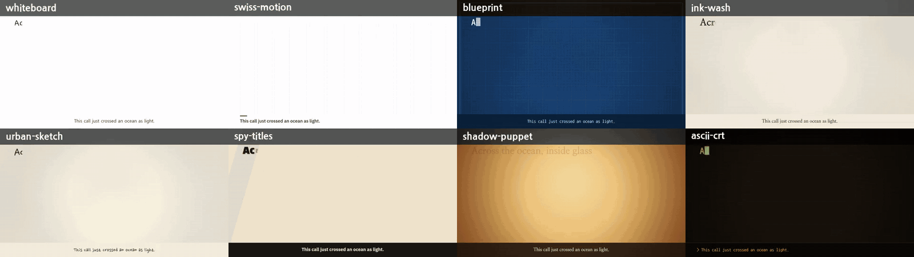
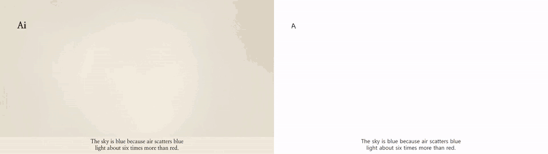
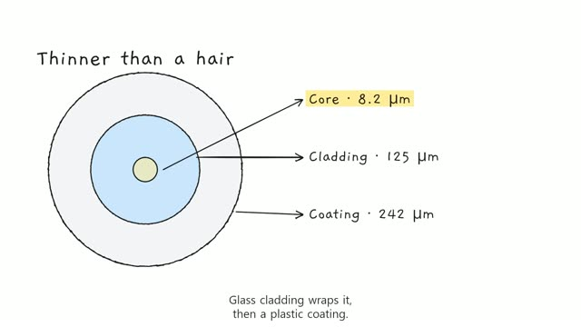
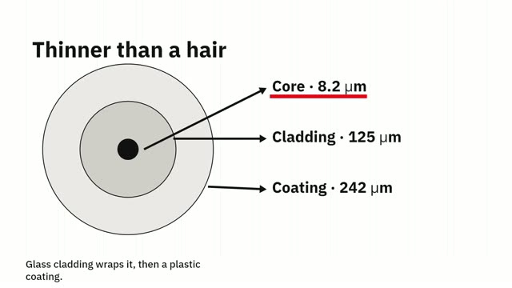
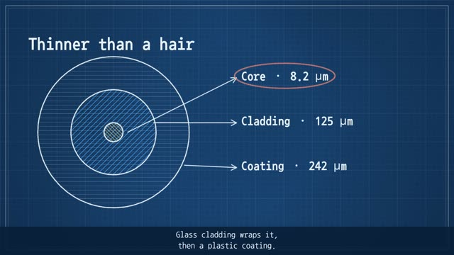
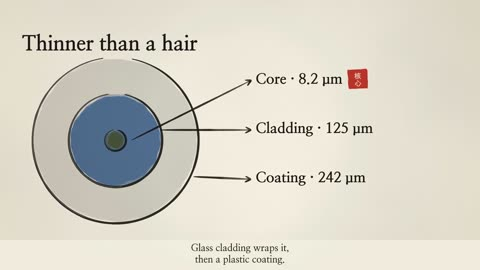
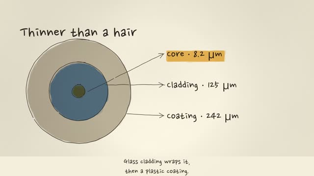
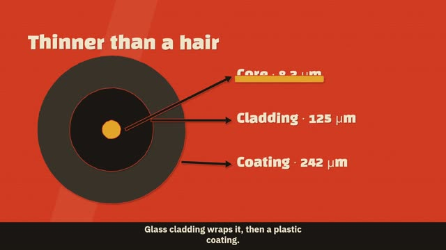
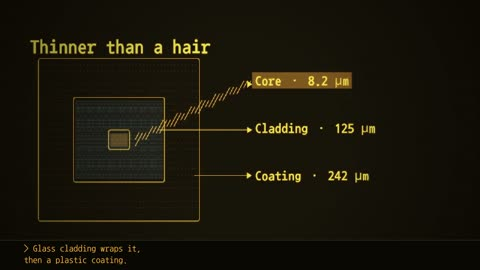

<p align="center"></p>

<p align="center">
<a href="https://github.com/reedodev/explainer-studio/actions/workflows/test.yml"></a>


</p>

**English** | [한국어](README.ko.md)

# Explainer Studio

**One line in, a narrated explainer video out, in eight hand-drawn styles.**

Give your coding agent a topic like *"How does a fiber-optic cable carry light?"*. It writes a storyboard, and this engine draws it stroke by stroke as a whiteboard sketch, a blueprint, an ink-wash painting, a 60s spy title sequence and more, with voice-over and captions, straight to MP4. The demo above is one storyboard file rendered eight times (silent, with burned-in captions). Every number in it is sourced: see `examples/fiber-optics/research/sources.json`. A full single-style render is in [`docs/fiber-optics-blueprint.mp4`](docs/fiber-optics-blueprint.mp4), and a narrated Korean example (narrated in the author's own voice, made with a local voice model; any local TTS can be plugged in with `--tts cmd`) is in [`docs/ai-agent-vs-chatbot-ko-voice.mp4`](docs/ai-agent-vs-chatbot-ko-voice.mp4).

## New here? Start with this

### What it solves, and when to use it

You have a topic ("How does a fiber-optic cable carry light?") and you want a short explainer video with narration and captions, but you do not want to learn a video editor, rent a GPU or pay for a video-generation API. You give the topic to your coding agent. It writes a storyboard file, and this engine draws it frame by frame into an MP4 with an `.srt` caption file.

Use it for: a 45 to 60 second concept explainer, a lesson clip, a side-by-side comparison of two ideas. Do not use it for screen recordings, 3D scenes or characters that walk around (see [Limitations](#limitations)).

### Words you will see

| Word | Meaning |
|---|---|
| Claude Code | Anthropic's command-line program for giving an AI tasks. This skill runs inside it. |
| Skill | A folder of instructions that tells the AI how to do one kind of job. Once installed, you can ask for it in plain words. |
| Terminal | The text window where you type commands: PowerShell on Windows, the Terminal app on Mac. |
| Node.js | The program that runs this project's code. `npm` comes with it. |
| FFmpeg | A free tool that joins pictures and sound into an MP4. This project needs it. |
| Storyboard | The `storyboard.json` file: what appears on screen, where, when, and what the voice says in each scene. |
| TTS | Text-to-speech, the voice. `--tts silent` skips the voice so you can try everything without any voice setup. |
| SRT | A plain-text caption file. Every render writes one next to the video. |

### Check your setup

Type these in the terminal. Each should print a version number.

```bash
node -v
npm -v
ffmpeg -version
```

- `node -v` must show `v20` or higher (this guide was checked with v26.5.0, and the project's CI uses Node 22). Install: Windows `winget install OpenJS.NodeJS.LTS`, Mac `brew install node`. Reopen the terminal afterwards.
- `ffmpeg -version` must print a version line. Install: Windows `winget install Gyan.FFmpeg`, Mac `brew install ffmpeg`. Reopen the terminal afterwards. If it is installed but not on your PATH, set `FFMPEG_PATH` and `FFPROBE_PATH` to the full paths of the two programs.
- You need Claude Code only for the "ask in plain words" route. Install it from the [official guide](https://code.claude.com/docs/en/overview). The commands below work without it.

### Three steps

**1. Install.** Inside Claude Code:

```
/plugin marketplace add reedodev/explainer-studio
/plugin install explainer-studio@explainer-studio
```

To run the commands yourself instead, download the repository and install its packages once (about 15 seconds to download and 4 seconds to install on the machine used for this guide):

```bash
git clone https://github.com/reedodev/explainer-studio
cd explainer-studio
npm ci
```

**2. Ask your agent.** Copy these into Claude Code one at a time:

1. `Make an explainer video about how vaccines train the immune system with explainer-studio, blueprint style, no voice for now.`
2. `Render the same storyboard again in ink-wash style so I can compare the two.`
3. `Tell me where final.mp4 and subtitles.srt are, and fix any warnings in validation-report.md.`

Or run the bundled example yourself:

```bash
npm run es -- build examples/fiber-optics --tts silent --style blueprint
```

**3. Look at the result.** Open `examples/fiber-optics/variants/blueprint/final.mp4`. Also look at `contact-sheet.png` in the same folder (one frame per scene) and `validation-report.md` (what the checks found).

### What the run really prints

This is the output of the command above on a fresh clone (Windows, Node v26.5.0, FFmpeg 8.0.1; the first lines and the long overlap list are shortened, and the path is replaced by `...`). It took 43 seconds and exited with code 0:

```
Note: --tts silent writes no voice. Scene lengths are estimated from the text.
scene-01 6.738 silent
scene-02 7.123 silent
...
scene-07 7.892 silent
rendered blueprint scene-01 202
...
rendered blueprint scene-07 1600
contact sheet (one frame at 70% per scene): ...\examples\fiber-optics\variants\blueprint\contact-sheet.png
blueprint done: 53.3 s video in 42 s -> ...\examples\fiber-optics\variants\blueprint\final.mp4
0 error(s), 1 warning(s), 14 intended overlap(s) not listed as warnings
  text fit checked in all 8 styles
  warn  scene-04: sparse scene (elements cover 33% of the safe area (aim for 35%+): ...)
```

How to read it: one `scene-NN` line per scene with its length in seconds. Then one `rendered` line per scene (the number is the frame count). The last lines are the check result. **Errors stop the render; warnings do not.** The warning above only says scene 4 is a bit empty. The video is 1920x1080, 30 fps, H.264 video with AAC audio, 53.3 seconds long (checked with ffprobe). The caption file `subtitles.srt` is written to the project folder, `examples/fiber-optics/`.

Two things that surprise people: the build writes the measured scene lengths back into `examples/fiber-optics/storyboard.json`, so `git status` shows that file as modified (this is normal), and the other render commands below only work after a `build` has done that once.

More commands from the same folder (times on the same machine):

```bash
npm run es -- render examples/fiber-optics --style ink-wash        # about 30 s -> variants/ink-wash/final.mp4
npm run es -- styleframes examples/fiber-optics --styles all       # about 7 s  -> styleframes/contact-sheet.png
npm run es -- build examples/ai-agent-vs-chatbot-ko --tts silent   # about 12 s -> examples/ai-agent-vs-chatbot-ko/final.mp4
```

### When it gets stuck

Every row below was reproduced on a fresh clone.

| Symptom | Cause | Fix |
|---|---|---|
| `Error: ffmpeg was not found. Install FFmpeg (...)` and exit code 1 | FFmpeg is not installed or not on PATH | Install it (see above), reopen the terminal, check `ffmpeg -version`, or set `FFMPEG_PATH` / `FFPROBE_PATH` |
| `Error: no project found (missing ...\output\nope\storyboard.json)` | The folder name or path after `build` / `render` is wrong | Use an existing folder such as `examples/fiber-optics`, or create one with `npm run es -- init "Why do cats purr?" --slug cats` |
| `Validation failed for style ink-wash; render refused.` followed by many `ERROR scene-01 / title: invalid animation window` lines | `render` was run before any `build` or `tts`, so the storyboard has no measured scene lengths yet (also happens after `git checkout` restores the example's `storyboard.json`) | Run `npm run es -- build <folder> --tts silent` first, then `render` |
| `git status` shows `examples/fiber-optics/storyboard.json` modified | `build` writes the measured scene lengths into it | Expected. Keep it; restoring it with `git checkout` means running `build` again before `render` |
| `warn  scene-04: sparse scene (...)` | The scene covers less than 35% of the safe area | Not an error. Add or enlarge shapes if you want to remove it; the video is still rendered |

---

## Quick start

```bash
git clone https://github.com/reedodev/explainer-studio && cd explainer-studio
npm ci                                   # needs Node 20+ and FFmpeg on PATH
npm run es -- build examples/fiber-optics --tts silent --style blueprint
```

The video lands in `examples/fiber-optics/variants/blueprint/final.mp4` with burned-in captions (the storyboard's own `style` renders to `final.mp4` in the project folder; every other style goes to `variants/<style>/final.mp4`). For a voice, swap `--tts silent` for `sapi` (Windows, offline), `cmd` (any local TTS) or `edge` (online; it depends on an unofficial endpoint that returned HTTP 403 when last checked on 2026-10-20). Then try the same file in another look:

```bash
npm run es -- render examples/fiber-optics --style ink-wash        # -> variants/ink-wash/final.mp4
npm run es -- styleframes examples/fiber-optics --styles all       # one contact sheet, all 8 styles
npm run es -- build examples/ai-agent-vs-chatbot-ko --tts silent  # Korean example (5 scenes)
npm run es -- init "Why do cats purr?" --slug cats                 # 3-scene starter in output/cats, prints the next command
```

With Claude Code, install the skill and just ask: *"make an explainer video about how vaccines train the immune system, blueprint style"*.

```
/plugin marketplace add reedodev/explainer-studio
/plugin install explainer-studio@explainer-studio
```

## A second example: written only from the layout recipes

<p align="center"></p>

`examples/sky-blue` (6 scenes, 45 s, every number sourced in `research/sources.json`) was written by following only [the storyboard recipes](skills/explainer-studio/reference/storyboard-recipes.md): a results-first hook, a spectrum, a chart with a callout, an A-vs-B comparison, the sunset path and a recap. Each element finishes drawing by 65% of its scene, so most of every scene shows the finished picture.

## Eight styles, one storyboard

| Style | Look | Good for |
|---|---|---|
| <br>`whiteboard` | Black marker on a white board, drawn one stroke at a time | Concepts, lessons, comparisons |
| <br>`swiss-motion` | 12-column grid, black blocks, one red, snappy motion | One-sentence messages, principles |
| <br>`blueprint` | White drafting lines on cyanotype blue, typed annotations | How things work, systems, architecture |
| <br>`ink-wash` | Brush strokes that swell and taper, bleeding ink, a red seal | Reflection, attitude, insight |
| <br>`urban-sketch` | Sepia pen lines with watercolour that spills over | Stories from experience, everyday topics |
| <br>`spy-titles` | Four-colour cut paper, a new background every scene | Hooks, mysteries, versus stories |
| <br>`shadow-puppet` | Lamp-lit screen, leather puppets with light shining through | Fables, origins, history |
| <br>`ascii-crt` | Amber CRT where every line is a character grid | AI, code, automation, logs |

## Why it is different from video-model tools

- **Deterministic.** The same storyboard gives the same video, frame for frame. Fix a typo and re-render; nothing else changes.
- **No GPU, no paid API, no video model.** Frames are drawn on a CPU canvas and piped to FFmpeg. The demo's eight styles rendered in about 10 to 60 seconds each on a desktop PC.
- **Text is real text.** Titles, labels and captions are typeset, never hallucinated pixels, so numbers and spelling stay correct.
- **Checks before it renders.** Off-screen elements, captions colliding with content, tiny fonts, overflowing text and frozen screens are caught and auto-fixed where possible; remaining errors block the render. Half-empty scenes get a warning that says how to fill them.
- **Captions included.** An `.srt` file and burned-in captions come with every render, in English or Korean.
- **It keeps moving.** Each scene opens with the title and the first drawing together, then a slow deterministic camera push (or pan) and small idle motion on icons, arrows and highlights carry the held picture. Set `camera: "still"` or `fx.idle: false` to turn them off.

## How it works

`storyboard.json` says **what** appears **where** and **when** (text, boxes, circles, arrows, lines, icons, bar charts, highlights, images) in a 1920x1080 space, plus the narration for each scene. A style says **how** it looks and moves. The CLI measures the real length of the voice track, times each element to its sentence, validates the layout, and renders. The full storyboard guide for agents is in [SKILL.md](skills/explainer-studio/SKILL.md), with a copy-paste skeleton, a field table and six layout recipes with coordinates in [storyboard-recipes.md](skills/explainer-studio/reference/storyboard-recipes.md).

Voices: `edge` (Microsoft Edge neural voices via an unofficial endpoint: check the terms before commercial use; English and Korean picked automatically, or set `WV_EDGE_VOICE`), `sapi` (Windows), `cmd` (any local TTS through `WV_TTS_CMD='mytts --text {text} --out {out}'`), or `silent`.

## Limitations

- Landscape 1920x1080 only for now.
- No character rigs, 3D or screen recordings; the drawable elements are listed above. Motion is a gentle camera and small idle loops, not keyframed animation.
- Caption timing is proportional to sentence length, not word-level forced alignment.
- Passing the checks is not the same as watching the video. Watch it before you publish.

## Credits

- The style catalogue and the visual language of each style were informed by [lemomo-ai/lemo-opuscar](https://github.com/lemomo-ai/lemo-opuscar) (code MIT, docs CC BY 4.0). The documents and the element-based engine here were written from scratch.
- [Rough.js](https://github.com/rough-stuff/rough) (MIT), [@napi-rs/canvas](https://github.com/Brooooooklyn/canvas) (MIT), [FFmpeg](https://ffmpeg.org/), [msedge-tts](https://github.com/Migushthe2nd/MsEdgeTTS) (MIT), [zod](https://github.com/colinhacks/zod) (MIT).
- Fonts under the SIL Open Font License 1.1: Gaegu, Nanum Gothic / Myeongjo / Pen Script / Gothic Coding, IBM Plex Sans KR, Black Han Sans. Licence files are in `assets/fonts/`.

---

## 한국어

한국어 안내는 [README.ko.md](README.ko.md)에 있습니다. 처음 쓰시는 분을 위한 설명, 준비 확인, 따라 하기, 막힐 때 표를 한국어로 모두 적어 두었습니다.

MIT License. Third-party fonts and libraries keep their own licences.
